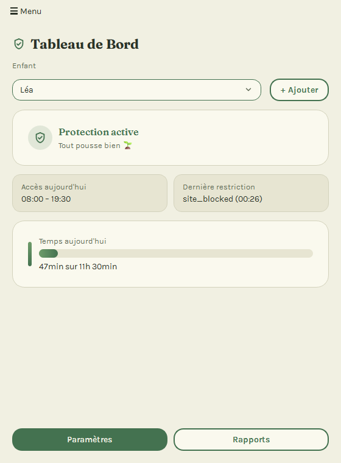
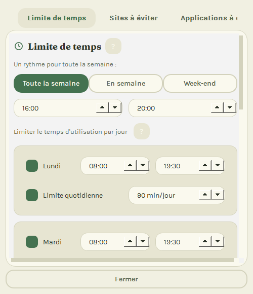
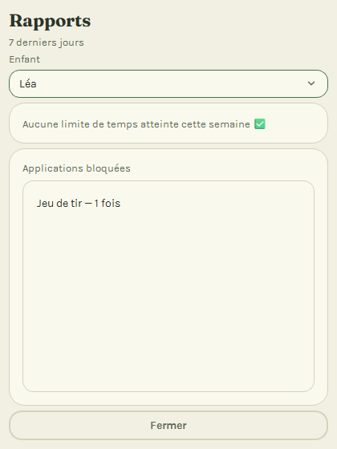

# MintGuard

[Français](README.md) · [English](README.en.md) · [Español](README.es.md)

[](https://github.com/tavenamicka/MintGuard/actions/workflows/ci.yml)
[](LICENSE)

Kindersicherung für Linux Mint — einfach und verständlich für Eltern ohne technische Vorkenntnisse, mit Bildschirmzeit-Limit sowie Sperre von Websites und Apps, in 4 Sprachen verfügbar (FR/EN/DE/ES).

> Status: Phase 3 (Sicherheit & Integration) abgeschlossen, Phase 4 (Tests & Release) läuft — DNS-Umschaltung, iptables, Sicherheitsaudit und Barrierefreiheitsaudit validiert. Die vollständigen Spezifikationen stehen in [PROJECT_BRIEF.md](PROJECT_BRIEF.md), der schrittweise Umsetzungsplan in [CLAUDE_CODE_BRIEFING.md](CLAUDE_CODE_BRIEFING.md) (beide auf Französisch).

## Überblick

Screenshots der Eltern-Oberfläche mit fiktiven Daten. Die Oberfläche selbst wird in Ihrer Sprache angezeigt (Französisch, Englisch, Deutsch oder Spanisch).

| Übersicht | Einstellungen: Zeitlimit | Berichte |
|---|---|---|
|  |  |  |

## MintGuard installieren (Eltern)

Computerkenntnisse sind nicht nötig: Folgen Sie einfach diesen 6 Schritten der Reihe nach. Planen Sie etwa 10 Minuten ein.

**Bevor Sie beginnen**, prüfen Sie Folgendes:
- Ihr Computer läuft mit **Linux Mint** (oder Ubuntu) und ist mit dem Internet verbunden;
- Sie kennen das **Passwort**, mit dem Sie sich anmelden;
- jedes Kind hat **sein eigenes Benutzerkonto** auf dem Computer (so erkennt MintGuard, wer ihn benutzt).

1. **Installationsdatei herunterladen.** Öffnen Sie die [Seite mit den Versionen](https://github.com/tavenamicka/MintGuard/releases/latest), scrollen Sie zu „Assets“ und klicken Sie auf die Datei `mintguard_0.1.1-1_all.deb` (oder eine höhere Nummer). Sie wird im Ordner **Downloads** gespeichert.
2. **Installation starten.** Doppelklicken Sie im Ordner Downloads auf diese Datei. Ein Fenster öffnet sich: Klicken Sie auf **Installieren**, geben Sie Ihr Passwort ein und warten Sie bis zum Ende (etwa eine Minute).
3. **MintGuard öffnen.** Klicken Sie auf das Menü des Computers (unten links), tippen Sie „MintGuard“ und klicken Sie auf das Symbol.
4. **Fragen des Assistenten beantworten.** Er fragt nach dem Vornamen Ihres Kindes, seinem Alter (für passende Einstellungen) und einem **PIN-Code** mit 4 Ziffern. Notieren Sie diesen Code auf Papier: Er schützt Ihre Einstellungen.
5. **Schutz aktivieren.** Erscheint die Meldung „Der Schutz ist noch nicht aktiv“, klicken Sie auf **„Schutz jetzt aktivieren“** und geben Sie Ihr Passwort ein. Fertig: MintGuard startet künftig bei jedem Start des Computers von selbst.
6. **Website-Sperre aktivieren.** Erscheint die Meldung „Die Website-Sperre funktioniert nicht“, klicken Sie auf **„Website-Sperre aktivieren“** und geben Sie Ihr Passwort ein. Ohne diesen Schritt funktionieren die Zeitlimits, aber keine Website wird gesperrt.

Probleme? Lesen Sie die [Installationsanleitung](docs/INSTALLATION.de.md), die Schritt für Schritt erklärt, was zu tun ist.

## MintGuard aktualisieren

**Welche Version haben Sie?** Sie steht im Titel des MintGuard-Fensters, zum Beispiel „MintGuard 0.1.1“. Steht im Titel nur „MintGuard“, haben Sie Version 0.1.0. Die Neuerungen jeder Version stehen auf der [Seite mit den Versionen](https://github.com/tavenamicka/MintGuard/releases) und im [Änderungsprotokoll](CHANGELOG.en.md) (auf Englisch).

**Zum Aktualisieren** wiederholen Sie die Schritte 1 und 2 mit der neuen Datei: herunterladen, doppelklicken, auf **Installieren** (oder **Aktualisieren**) klicken und Ihr Passwort eingeben. Die alte Version muss nicht deinstalliert werden: Ihre Kinder, ihre Zeitpläne, gesperrte Websites und Apps sowie Ihr PIN-Code bleiben erhalten.

**Nach der Aktualisierung** öffnen Sie MintGuard. Bietet eine Karte „Schutz jetzt aktivieren“ oder „Website-Sperre aktivieren“ an, klicken Sie darauf und geben Sie Ihr Passwort ein. Das ist beim Wechsel von 0.1.0 auf 0.1.1 der Fall; ab 0.1.1 startet der Schutz nach jeder Aktualisierung von selbst neu.

## Benutzerhandbuch

Für Eltern: [Français](docs/USER_MANUAL_FR.md) · [English](docs/USER_MANUAL_EN.md) · [Deutsch](docs/USER_MANUAL_DE.md) · [Español](docs/USER_MANUAL_ES.md)

## Architektur

```
Oberfläche (PyQt6, Eltern)
        │  D-Bus / Socket
Backend-Daemon (systemd, root)
   ├── DNS Controller (dnsmasq)
   ├── Firewall Controller (iptables)
   ├── Process Monitor (psutil)
   └── Session Manager (loginctl)
```

## Installation (Entwicklung)

```bash
python -m venv .venv
source .venv/bin/activate    # .venv\Scripts\activate (Windows)
pip install -e .
pip install -r requirements.txt
```

## Tests ausführen

```bash
pytest tests/ -v
pytest tests/ --cov=mintguard
```

## App starten (Entwicklung)

```bash
mintguard              # Oberfläche
python -m mintguard.daemon   # Daemon (benötigt in der Entwicklung kein Root)
```

In der Entwicklung kann der Pfad der Konfigurationsdatei überschrieben werden:

```bash
export MINTGUARD_CONFIG_PATH=/tmp/mintguard-config.json
```

Ohne diese Variable versucht MintGuard, `/etc/mintguard/config.json` zu lesen, und greift bei Fehlen auf Standardwerte zurück (siehe [etc/config.json.example](etc/config.json.example)).

## Projektstruktur

Siehe [PROJECT_BRIEF.md](PROJECT_BRIEF.md), Abschnitt „Structure de Répertoires“ (auf Französisch).

## Für Mitwirkende

Siehe [docs/DEV_SETUP.md](docs/DEV_SETUP.md) (Einrichtung in 5 Minuten) und [CONTRIBUTING.md](CONTRIBUTING.md).

## Lizenz

MintGuard wird unter der [GNU General Public License v3.0 oder später](LICENSE) (GPL-3.0-or-later) verbreitet. Siehe [docs/LICENSE_COMPLIANCE.md](docs/LICENSE_COMPLIANCE.md) zur Kompatibilität der Abhängigkeiten und [AUTHORS.md](AUTHORS.md) für die Mitwirkenden.
